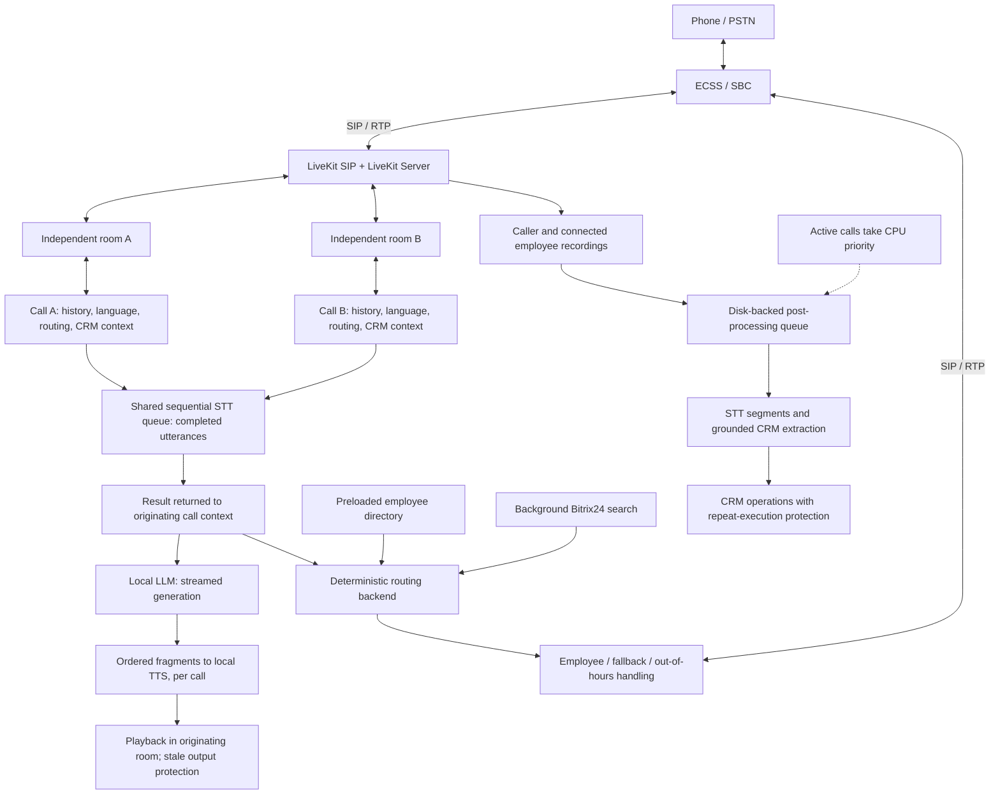

# Legacy → MultiCall

**Limited pilot / ongoing validation. Not production-ready.**

The transition extends the working CPU-only RU/KZ SIP PoC rather than replacing
its engineering history. Legacy's shared state and single-session-oriented media
pipeline motivated independent call ownership. This is documentation of reported
project results, not a release of private implementation code.

## Architecture and State Ownership

This is a sanitized logical diagram. Shared boxes describe functional resources,
not a claim that every inference engine runs in parallel. Room identity and call
context remain associated throughout processing and playback.

## What Changed

| Boundary | MultiCall result |
|---|---|
| Room and session ownership | Independent LiveKit rooms and separate state for each call |
| Conversation context | Isolated history, language, routing and CRM context |
| Interruption lifecycle | Protection against stale replies after barge-in |
| Response delivery | Streaming LLM generation with sequential fragment delivery to TTS |
| Speech recognition | Completed-utterance STT; the STT queue remains sequential |
| Routing | Deterministic decisions outside the LLM, preserving RU/KZ, transfer, fallback and out-of-hours scenarios |
| Business-data lookup | Background CRM search and employee-directory preloading |
| Recording | Recordings of the caller and connected employee |
| Post-call work | Disk-backed queue with priority for active calls |
| CRM side effects | Protection against repeated execution of potentially non-idempotent operations |

Stale-output protection matters even when state is isolated: generation started
before an interruption must not later play as if it belonged to the current turn.
Ordered TTS fragments preserve response sequence while LLM generation streams.
Neither result means that STT itself is streaming.

CRM lookup and directory preloading move lookup work away from the immediate
conversation path. No measured lookup-latency improvement is claimed. Repeat
execution protection addresses CRM side effects; its presence does not establish
exactly-once delivery or confirm automatic deal creation. The specific deduplication
mechanism and queue storage format are not supplied in the public project summary.

The [earlier routing note](routing-and-sip-handoff.md) remains canonical for
employee matching, fallback-field preservation, final SIP outcome and Caller ID.
The [Legacy lifecycle note](lifecycle-and-post-call.md) retains the earlier
hangup-cancellation and process-group scheduling lessons. The new disk-backed
queue does not, on its own, prove recovery from a physical power interruption.

## Reported Validation

The project owner reports the following completed checks. These were not rerun
as part of this documentation update; raw call artifacts and private CRM records
are not published.

| Check | Reported result | Scope limit |
|---|---|---|
| Two independent simultaneous calls | Confirmed | Does not establish tens of concurrent conversations or all interleavings |
| Main dialog scenarios and RU/KZ handling | Checked | Does not establish full Legacy equivalence or error-free language switching |
| Transfers | Checked | Does not establish every carrier/PBX or failure scenario |
| CRM post-processing | Checked | Does not confirm automatic deal creation or all retry/crash paths |

### Limited STT Timing Experiment

Four recognitions of one three-second test audio fragment were timed:

| Execution mode | Total elapsed time for four recognitions |
|---|---|
| Sequential | Approximately 9.14 seconds |
| Parallel | Approximately 7.15–7.70 seconds |

This is a bounded experiment, not a full load test, a per-call response-time
measurement or evidence that the deployed STT queue is parallel. The current
queue remains sequential. Run count, worker configuration and statistical
distribution are not provided, so none are inferred.

CPU contention remains a constraint across STT, LLM, TTS and background work.
Dual RU/KK recognition during language determination adds recognition work and
can amplify contention. Its separate cost was not quantified in this experiment.
Parallel recognition reduced elapsed time for this fragment but did not yield
linear scaling; further optimization and representative call tests are needed.

## Current Validation Boundary

Do not infer the following from the completed transition:

- Capacity for tens of simultaneous conversations.
- Complete behavioral equivalence with Legacy.
- Elimination of false interruptions or speakerphone echo.
- Confirmed automatic creation of CRM deals.
- Physically tested recovery after power loss.
- Production readiness or completion of the previously listed security hardening.

See [engineering lessons](multicall-engineering-lessons.md) for the diagnostic
issues encountered during this stage, their concrete fixes and separate automated,
saved-audio and live-call validation limits. These include persistent greeting
interruptions in 6 of 10 calls and a single-fragment Whisper output-limit comparison;
neither should be generalized into a reliability or capacity claim.

## Roadmap

1. Optimize the sequential STT path and assess the cost of dual RU/KK recognition.
2. Evaluate streaming STT separately from the implemented LLM streaming path.
3. Test GPU acceleration; the documented baseline remains CPU-only.
4. Improve noise/echo robustness and retest barge-in on speakerphone calls.
5. Define acceptance criteria for isolation, language behavior, stale-output
   rejection, transfers, recordings, queue lifecycle and CRM side effects.
6. Expand load testing with representative simultaneous calls and background
   work; measure end-to-end behavior before making capacity claims.

[Project overview](README.md) · [Engineering lessons](multicall-engineering-lessons.md)
